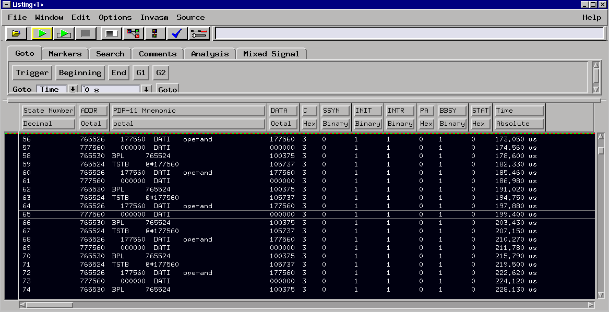
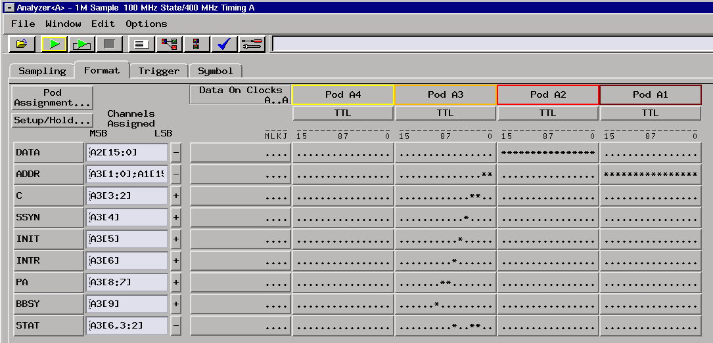

# PDP-11 (Unibus) inverse assembler for HP logic analyzers

An inverse assembler for HP 1650/1660/1670, 16500 and 16600/16700 (e.g.
16702A) logic analyzers. It turns Unibus cycles captured by the analyzer
into PDP-11 mnemonics, displayed in octal:

```
ADDR    PDP-11 Mnemonic
004032  INC     002016
004034    175760  DATI   operand
002016    000004  DATIP
002016    000005  DATO
004036  BIT     #000001,R3
004040    000001  DATI   operand
004042  BEQ     004046
000000    000100  INTR
000100    004234  DATI   vector
000102    000340  DATI   vector
000776    000340  DATO
000774    004036  DATO
004234  INC     002020
...
004240  RTI
000774    004036  DATI
000776    000340  DATI
004036  BIT     #000001,R3
```

It decodes the complete instruction set of the Unibus machines: basic
instructions, EIS (MUL DIV ASH ASHC XOR SOB), FIS (FADD ...), FP11 floating
point, MARK, SPL, MFPI/MTPI/MFPD/MTPD, MFPS/MTPS, SXT, MFPT, CSM, TSTSET,
WRTLCK. Anything else shows as `.WORD nnnnnn`.

## Example on an 16702A:

This uses the [Unibus Terminator with LA probe](https://github.com/fjalvingh/unibus-la-terminator) to connect the logical analyzer to a PDP 11/05. The trace is of the 11/05 waiting for console input while running the console prom from the m9312:



## Files

| Path | What |
|---|---|
| `src/IPDP11.S` | IAL source (HP Inverse Assembler Language) |
| `out/IPDP11.R` | assembled relocatable file, from the HP 10391B `ASM.EXE` |
| `out/IPDP11` | analyzer disk file (what IALDOWN would create), Invasm option B |
| `out/IPDP11.LST` | assembler listing with cross reference |
| `build.sh` | assembles with `iadisk/ASM.EXE` under the emu2 DOS emulator |
| `tools/mkiafile.py` | wraps a `.R` file into the analyzer disk file format |
| `test/` | IAL interpreter, reference disassembler, Unibus CPU model and tests |

## Building

`ASM.EXE` is a DOS program. `build.sh` runs it with
[emu2](https://github.com/dmsc/emu2), a small DOS emulator for the Linux
terminal:

```
./build.sh
```

It uses `$EMU2` if set, else `emu2` from your PATH. Failing both, it clones
and builds emu2 into `tools/emu2/` on first use (needs git, make and a C
compiler).

The script copies `iadisk/TABLES/AIAL.txt` to `\HP64700\TABLES\AIAL`, where
the assembler expects it. It then assembles, checks `Errors= 0` and writes the
`out/` files.

Under DOSBox or real DOS, do the same thing by hand: put `AIAL` in
`\HP64700\TABLES` (or `SET HPTABLES=...`), then run `ASM -ox IPDP11.S`.

## Loading it into the analyzer

16600/16700 (e.g. 16702A). Use either route:

* Copy `out/IPDP11` to the analyzer (ftp or floppy) and load it with the
  File Manager. After the first load a copy is kept in `/logic/ia`, so later
  you can pick it from the Invasm pull-down in the Listing window.
* Or copy `out/IPDP11.R` and convert it with the IA Format utility into
  `/logic/ia`, then load it from the Listing window.
* FTP the file to /logic, then load with the File Manager. The File Manager
  will convert the file and put it in the "ia" directory after.  

1650/16500 series: copy `out/IPDP11` to an LIF/DOS floppy, or download
`IPDP11.R` with IALDOWN. Choose Invasm field option **B**.

Define the `ADDR`, `DATA` and `STAT` labels (below) **before** loading the
inverse assembler. Then set the base of the DATA column in the listing to
Invasm.

## Probing the Unibus

Use a state analyzer with these labels:

| Label | Bits | Signals | Remarks |
|---|---|---| --- | 
| `ADDR` | 18 | A17..A00 | Use '-' on the signals: Unibus signals are inverted! |
| `DATA` | 16 | D15..D00 | Use '-' on the signals: Unibus signals are inverted! |
| `STAT` | 3 | bit 0 = C0, bit 1 = C1, bit 2 = INTR (optional, tie low if not probed) | Use '-' on the signals: Unibus signals are inverted! |

* All Unibus signals are asserted low. Set the polarity of all three labels
  to **negative**, so that 1 = asserted and the ADDR/DATA columns read
  correctly. Use the TTL threshold.
* C1 C0: 00 DATI, 01 DATIP, 10 DATO, 11 DATOB.
* **State clock: MSYN negation** (the rising edge of the MSYN L line). At
  that point address, data and C1/C0 of every transfer (CPU and DMA) are
  still on the bus.
* Optional: to also capture interrupt vector transfers, add a second clock
  edge on SSYN assertion qualified by INTR asserted. The device's vector is
  then on the D lines. It shows as an `INTR` line, and the IA uses it to
  identify the vector fetch. Without it the IA still recognises interrupts
  (see below).
* Set the ADDR column base to octal to match the mnemonics.
* Make sure to set the clock signal on SSYN, rising.

Example format on the HP 16702A:




## Using it

The Unibus doesn't tell an instruction fetch from a data read, so the
listing has to be synchronized once, like the HP 68000 inverse assemblers:

1. Before syncing, every state shows as a raw bus cycle (`data  cycle`).
2. Roll a state you know is an instruction fetch (a branch target, a
   known routine entry ...) to the top of the listing.
3. Select the **Invasm** field. From there on the listing is decoded, and
   further states are decoded as you scroll forward.

How each line reads:

* `MNEMONIC operands` is an instruction fetch. Addresses (branch targets,
  PC-relative operands) are bus addresses, the same as the ADDR column. If
  the ADDR label base is set to *symbol*, they are replaced by symbols.
* `data  DATI   operand` is an extension word (immediate, absolute or index)
  of the instruction above.
* `data  DATI   vector` is the new PC/PS read from an interrupt or trap
  vector.
* `data  DATI/DATIP/DATO/DATOB` is any other bus cycle: operand data,
  stack pushes and pops, DMA. For DATOB only the written byte is shown.

### How the next instruction is found

After decoding an instruction, the IA looks up to 32 states ahead. In that
window it:

* takes the reads of the following addresses as the extension words;
* predicts where the next fetch will be:
  * the next sequential address, or either branch destination;
  * the target given by `@#x` / PC-relative `JMP`/`JSR`, or `MOV #x,PC`;
  * for `RTS PC`, `RTI`, `RTT`, deferred `JMP`/`JSR` and `MOV (SP)+,PC`,
    the data of the read that fetched the new PC;
  * when the target depends on a register (`JMP (R0)`, `RTS R5`, `MOV
    R0,PC` ...), the first read at an address X that is followed by a read
    of X+2. A control-transfer instruction at X needs no X+2 read;
* treats a read pair V, V+2 below 1000 (octal) as an interrupt or trap
  vector: next to two stack pushes, or announced by an INTR cycle. The new
  PC comes from the read at V;
* tags all of these states, so they show as data and the predicted fetch is
  decoded next.

If the next fetch can't be found (unknown target and DMA at just the wrong
moment, a deeply nested interrupt, a cached CPU ...), the chain is lost
there. The IA then tries each following unclaimed read as an instruction,
and keeps one only if its own next fetch is found. So the listing usually
resynchronizes by itself within a few lines.

### Limitations

* Meant for CPUs whose instruction fetches all appear on the Unibus, without
  prefetch or cache: 11/04, 11/05, 11/10, 11/15, 11/20, 11/34 (no cache),
  11/35, 11/40. On cached machines (11/34 with cache, 11/44, 11/60, 11/70,
  11/84) or with memory on a private bus, many fetches never reach the
  Unibus. Only the cycles that do reach it are decoded.
* With memory management on, the ADDR column shows physical addresses.
  Branch and PC-relative targets are computed from the physical address of
  the instruction. Absolute and immediate operands are printed as written
  (virtual). Next-fetch matching for virtual jump targets only compares the
  low 13 bits (the offset within the 8 KB page).
* Code running in the I/O page (boot ROMs at 773000 etc.) is handled: PC
  relative arithmetic there wraps at 16 bits as on a real CPU.
* `VEC_LIMIT`, `SCANMAX` and `GUESSMAX` at the top of `src/IPDP11.S` can
  be tuned.
* Re-syncing in a region that was already decoded may keep the earlier
  decoding of that state. Press Run for a fresh acquisition if that
  happens.

## Tests

The tests run the IAL source itself in a Python model of the analyzer's
inverse assembler engine (`test/ialsim.py`):

```
python3 test/test_opcodes.py    # all 65536 opcodes vs. a reference disassembler
python3 test/test_trace.py      # emulated program: DMA, interrupts, traps, I/O page code
python3 test/test_stress.py 20  # 80k instructions: heavy DMA, high vectors
```

Results: all 65536 opcodes decode like the reference. Emulated traces decode
with no wrong lines, apart from 0.06% under 40% DMA bus load. The worst
state needs about 1000 IAL instructions; the analyzer limit is
MAX_INSTRUCTION 30000.

These tests check the logic, not the analyzer. The source assembles with 0
errors in the real HP assembler. The disk file format was checked
byte-for-byte against analyzer-generated files. It has **not** yet been run
on a real 16702A.
